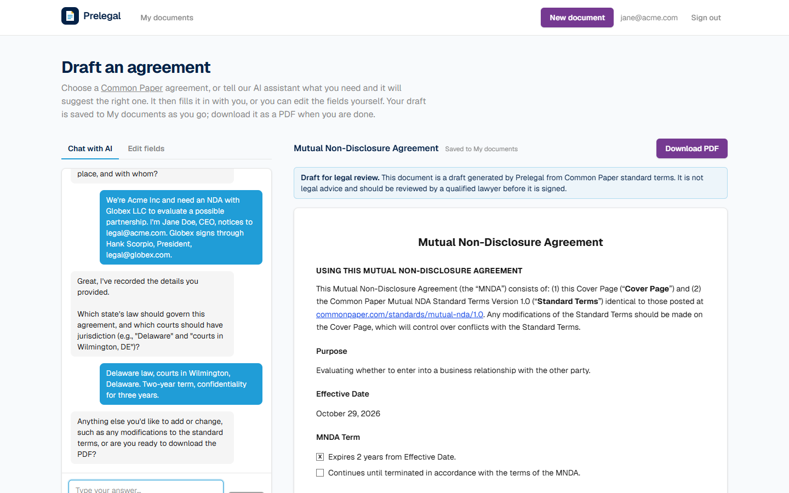
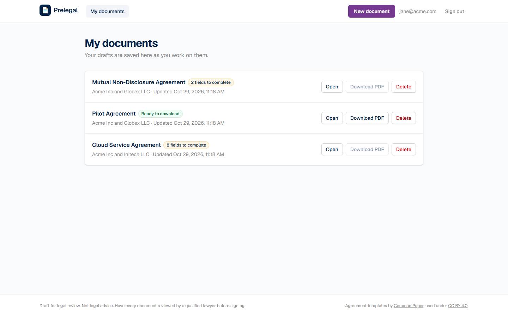
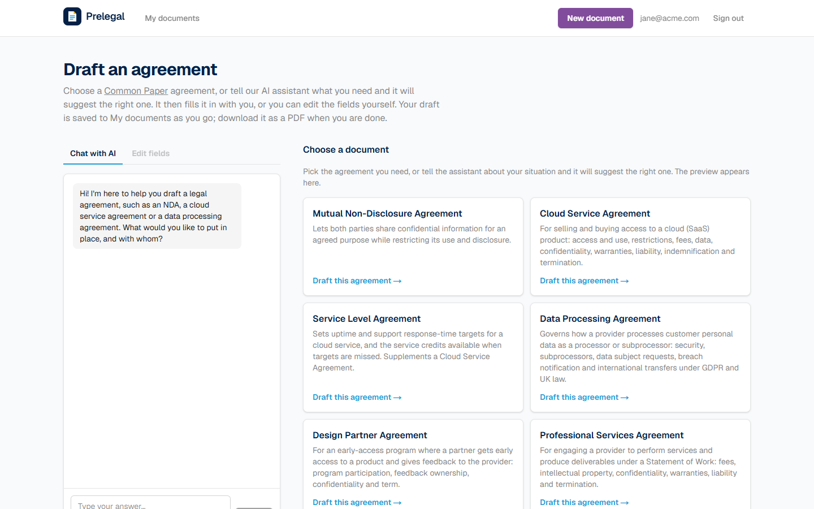
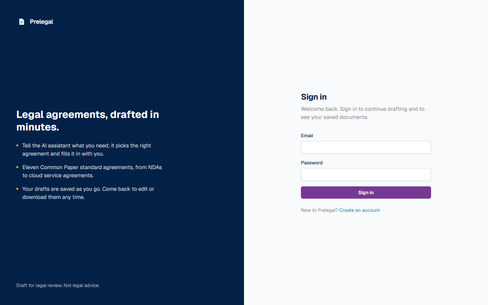

# Prelegal

[](https://github.com/mvprm/prelegal/actions/workflows/ci.yml)
[](LICENSE)


**Draft common legal agreements by chatting with an AI assistant.** Tell Prelegal what you
need. It picks the right standard agreement, asks about your deal, and fills in the
agreement as you talk. Then download it as a PDF, ready for legal review. Built on
[Common Paper](https://commonpaper.com/standards/)'s free, lawyer-drafted standard agreements.



## Features

- **11 agreement types:** Mutual NDA, Cloud Service, Service Level, Data Processing, Design
  Partner, Professional Services, Partnership, Business Associate, Software License and
  Pilot agreements, and an AI Addendum.
- **Choose or chat:** pick an agreement from the list, or describe your situation and the
  assistant suggests one. If you ask for something Prelegal can't draft, it says so and
  offers the closest agreement it can.
- **Guided drafting:** the assistant asks about the parties and the terms one step at a time,
  and the live preview updates as you answer. You can also edit any field in a form.
- **Your documents, saved:** sign up to get your own space. Drafts are saved automatically,
  and **My documents** lets you reopen, download, rename or delete them.
- **PDF export:** the cover page and Standard Terms are generated in the browser.
- **Draft disclaimer:** every document, on screen and in the PDF, is marked as a draft for
  review by a qualified lawyer.

| My documents | Choosing an agreement | Sign in |
| --- | --- | --- |
|  |  |  |

## Quick start

Requires [Docker](https://www.docker.com/).

```bash
git clone https://github.com/mvprm/prelegal.git
cd prelegal
cp .env.example .env    # then set OPENROUTER_API_KEY for the AI assistant
scripts/start-mac.sh    # or scripts/start-linux.sh, or scripts\start-windows.ps1
```

Open **http://localhost:8000** and create an account. The API docs are at
http://localhost:8000/api/docs. To stop the app, run `scripts/stop-mac.sh`,
`scripts/stop-linux.sh` or `scripts\stop-windows.ps1`.

Accounts and documents are kept in a Docker volume, `prelegal-data`, so they survive
stopping, restarting and updating the app. To start over with an empty database, stop the
app and run `docker volume rm prelegal-data`, or set `PRELEGAL_RESET_DB=true` in `.env` to
empty it on every start.

## How it works

```
Browser ── static Next.js app (chat, form, live preview, PDF) ──┐
                                                                 │ same origin, session cookie
FastAPI ── /api/auth, /api/documents ── SQLite in a Docker volume (users, sessions, documents)
        └─ /api/chat ── LiteLLM → OpenRouter → gpt-oss-120b on Cerebras (Structured Outputs)
```

- **Frontend** ([`frontend/`](frontend/)): Next.js 16, React 19, TypeScript and Tailwind CSS
  v4. It is exported as static files and served by the backend. The preview and the PDF
  ([`@react-pdf/renderer`](https://react-pdf.org)) are made in the browser.
- **Backend** ([`backend/`](backend/)): FastAPI on Python 3.13, managed with
  [uv](https://docs.astral.sh/uv/). It handles accounts (scrypt password hashes, HttpOnly
  session cookies), saved documents and the AI chat.
- **AI assistant:** stateless. Each message sends the conversation and the current draft.
  The model answers in a JSON schema built from the chosen document's fields, so it can only
  fill in fields that exist. The backend checks every value before accepting it.
- **Agreements:** the Common Paper templates live in [`templates/`](templates/).
  [`documents.json`](documents.json) describes each agreement's parties and fields, and it
  drives the chat, the form and the cover page on both the frontend and the backend.

The [frontend README](frontend/README.md) and the [backend README](backend/README.md)
explain the details.

## Development

The frontend reads `../templates` and `../documents.json`, so run everything from a full
checkout.

```bash
# Frontend: Node.js 24
cd frontend
npm install
npm test             # unit tests (Vitest), including real PDF renders
npm run lint
npm run build        # static site in frontend/out/, which the backend serves

# Backend: Python 3.13 with uv
cd backend
uv run pytest                                                              # tests (real temporary SQLite; LLM stubbed)
uv run --env-file ../.env uvicorn --factory app.main:create_app --reload   # http://localhost:8000
```

`npm run dev` (http://localhost:3000) runs without the API, so signing in and the chat only
work through the backend or Docker. The tests that call the real LLM run only when
`OPENROUTER_API_KEY` is set. [CI](.github/workflows/ci.yml) runs the backend tests, the
frontend lint, type check, tests and build, and the Docker build on every push and pull
request.

### Repository layout

```
prelegal/
├── frontend/       # Next.js web app, exported as static files
├── backend/        # FastAPI app: the API and the server for the frontend
├── templates/      # Common Paper agreement templates (markdown, CC BY 4.0)
├── documents.json  # The supported agreements and their fields
├── catalog.json    # Name, description and filename of every template
├── scripts/        # Start and stop scripts for macOS, Linux and Windows
├── docs/           # Screenshots
└── Dockerfile      # Builds the frontend, then packages it with the backend
```

## Project history

Work is tracked in Jira (project **PL**).

| Ticket | Scope | Status |
| --- | --- | --- |
| PL-1 | A simple website that describes the Prelegal company | To do |
| PL-2 | Dataset of Common Paper agreement templates | ✅ Done |
| PL-3 | Prototype of a Mutual NDA creator: form, preview and PDF download | ✅ Done |
| PL-4 | V1 foundation: FastAPI backend, SQLite, Docker, start/stop scripts | ✅ Done |
| PL-5 | AI chat that fills in the Mutual NDA | ✅ Done |
| PL-6 | All 11 agreement types via AI chat, with help choosing the right one | ✅ Done |
| PL-7 | Accounts, saved documents, a professional look and the draft disclaimer | ✅ Done |
| PL-8 | Bug fixes: choose the agreement from a list; reopening a saved document | ✅ Done |
| PL-9 | Bug fix: the AI keeps what the user said in their first message over the defaults | ✅ Done |
| PL-10 | Styled dialogs instead of the browser's popups | ✅ Done |
| PL-11 | Rename saved documents | ✅ Done |
| PL-12 | Persistent database: accounts and documents survive restarts | ✅ Done |

## License

- **Code** is released under the [MIT License](LICENSE).
- **Agreement templates** in `templates/` are © Common Paper, used under
  [CC BY 4.0](https://creativecommons.org/licenses/by/4.0/). See
  [`templates/LICENSE.txt`](templates/LICENSE.txt) for attribution details.

Prelegal is not affiliated with or endorsed by Common Paper. Documents it generates are
drafts, not legal advice: have them reviewed by a qualified lawyer before signing.
